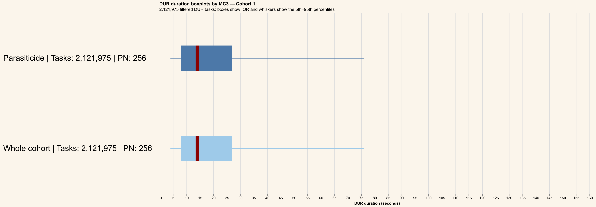
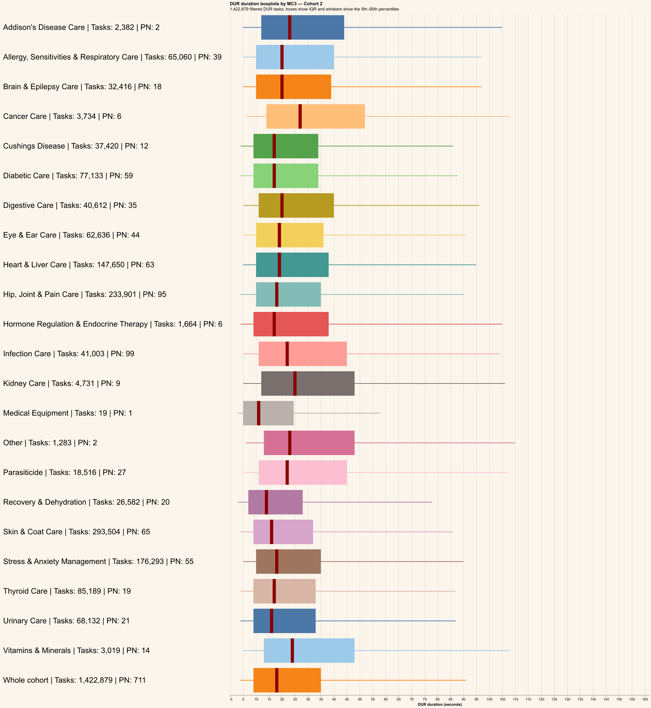
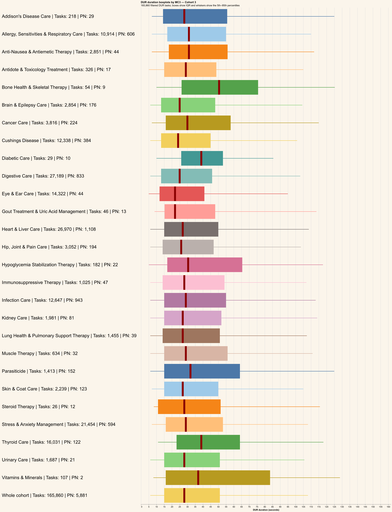
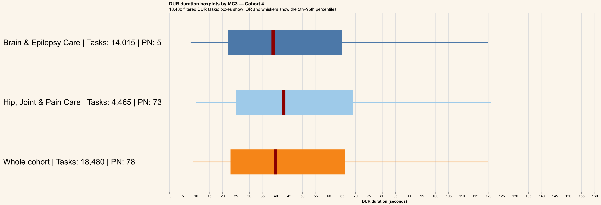
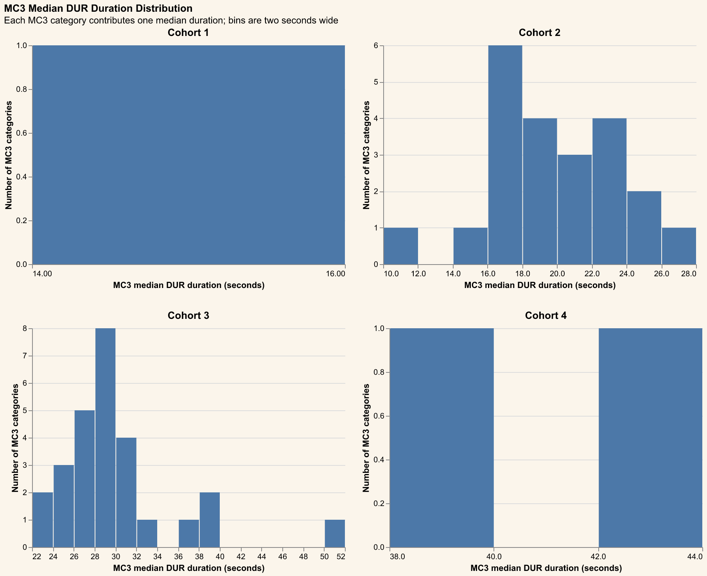

# MC3 analysis

DUR tasks are filtered to Cohort 1–4, non-refill tasks, no handoff, and non-null part numbers.
Durations at or above the filtered population's approximate 95th percentile are excluded.
Product rows are joined by `PART_NUMBER`; missing or blank `MERCH_CLASSIFICATION3` values are shown as `<Missing>`.
Each chart contains vertically stacked horizontal boxplots, one per MC3 plus a final `Whole cohort` boxplot; adjacent labels show task and PN counts, dark-red lines show medians, and whiskers show the 5th–95th percentiles.
The median-duration histogram counts MC3 categories in two-second bins separately for each cohort.
Cached task-level data is stored at `outputs/data/mc3-analysis.parquet` for redraw-only runs.

## Cohort 1

## Cohort 2

## Cohort 3

## Cohort 4

## MC3 median DUR histogram

