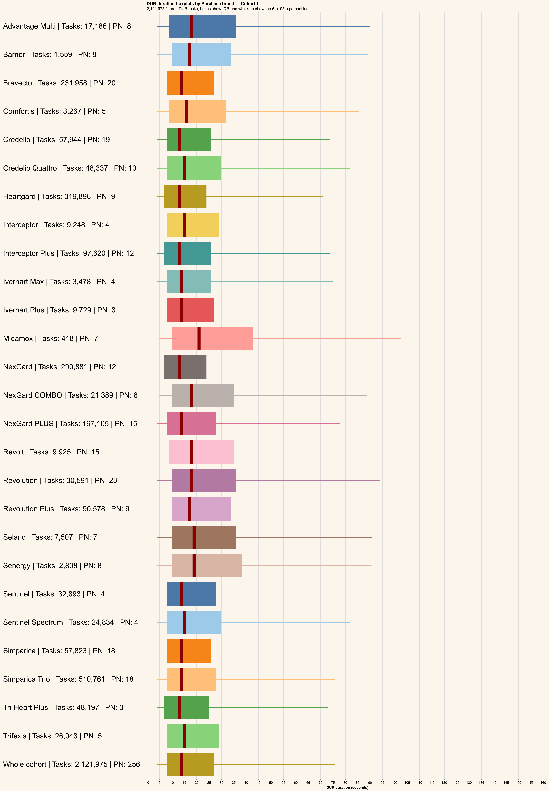
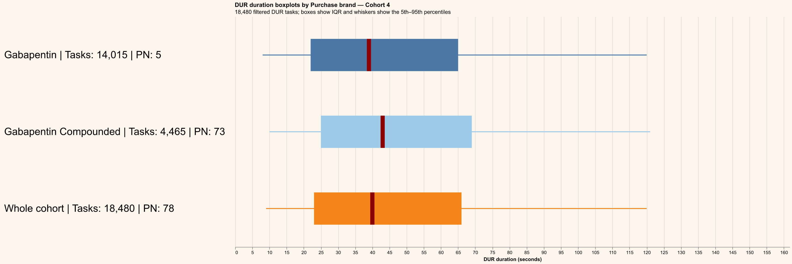
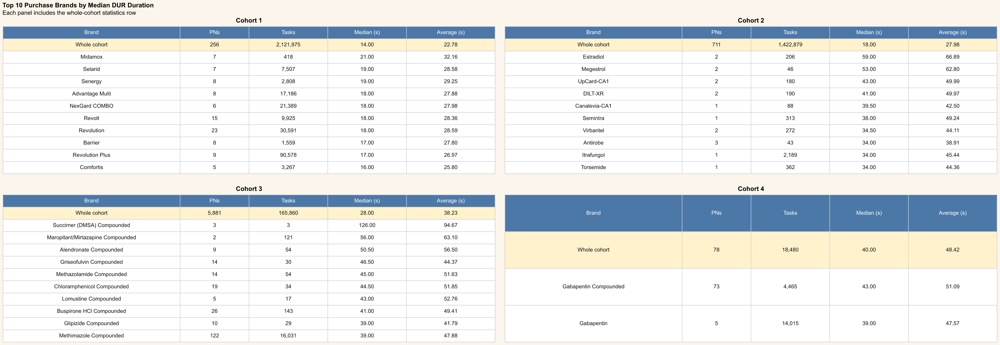
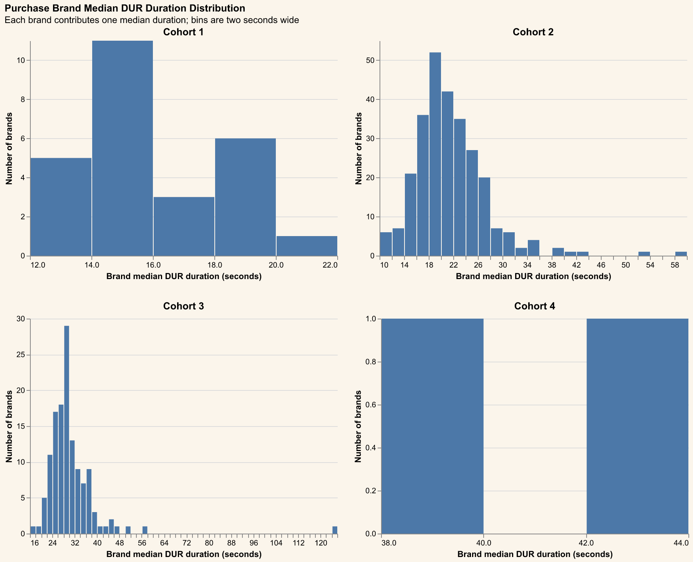

# Purchase Brand analysis

DUR tasks use the same known-cohort, non-refill, no-handoff, part-number, and approximate 95th-percentile filters as the MC3 analysis.
Product rows are joined by `PART_NUMBER`; missing or blank `PURCHASE_BRAND` values are shown as `<Missing>`.
Each chart contains vertically stacked horizontal boxplots, one per purchase brand plus a final `Whole cohort` boxplot. Adjacent labels show task and PN counts; dark-red lines show medians.
The median-duration histogram counts purchase brands in two-second bins separately for each cohort.
Cached task-level data is stored at `outputs/data/purchase-brand-analysis.parquet` for redraw-only runs.

## Cohort 1

## Cohort 2

## Cohort 3

## Cohort 4

## Top 10 Purchase Brand statistics table

## Purchase Brand median DUR histogram

