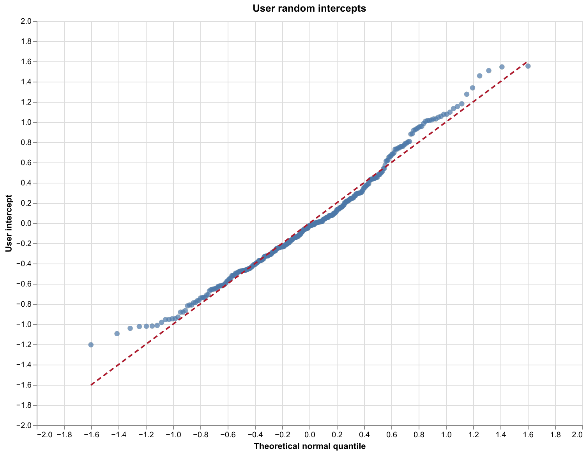
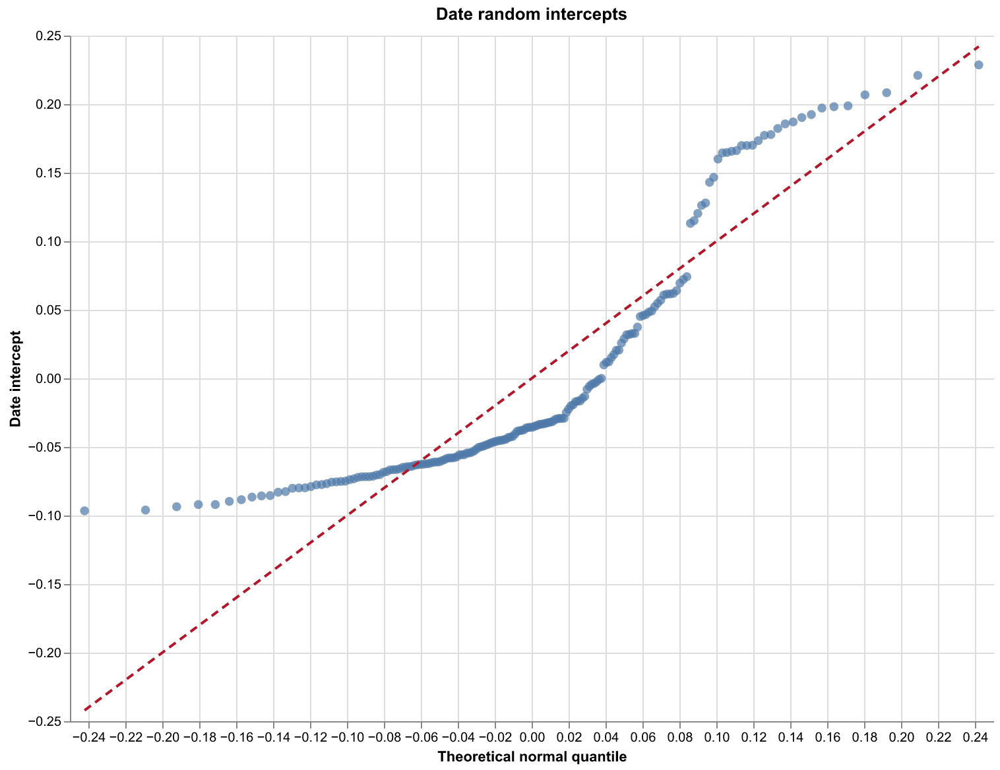
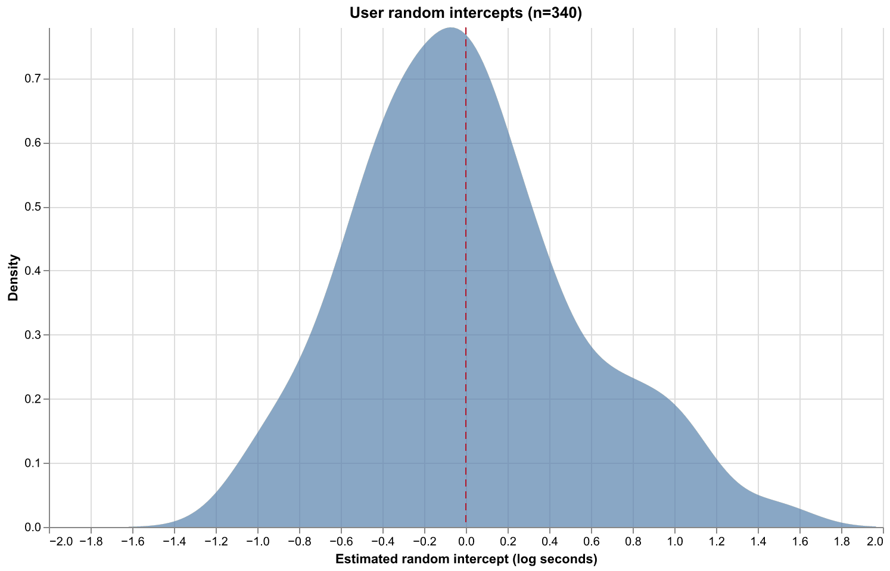
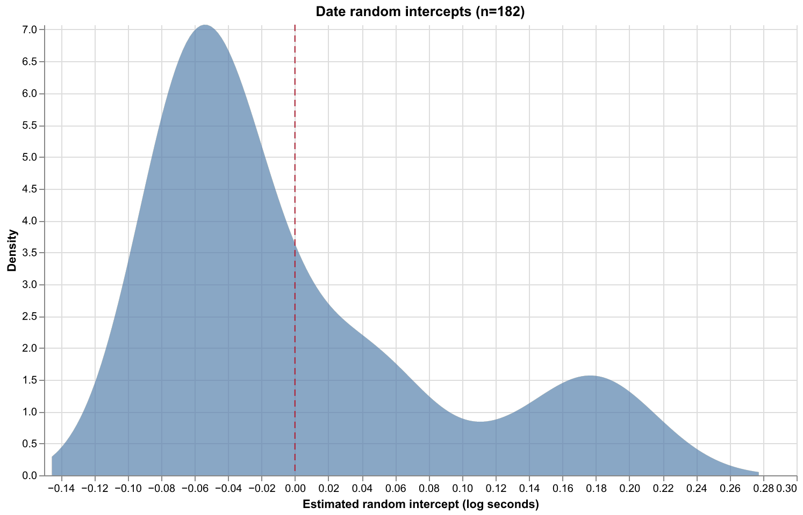
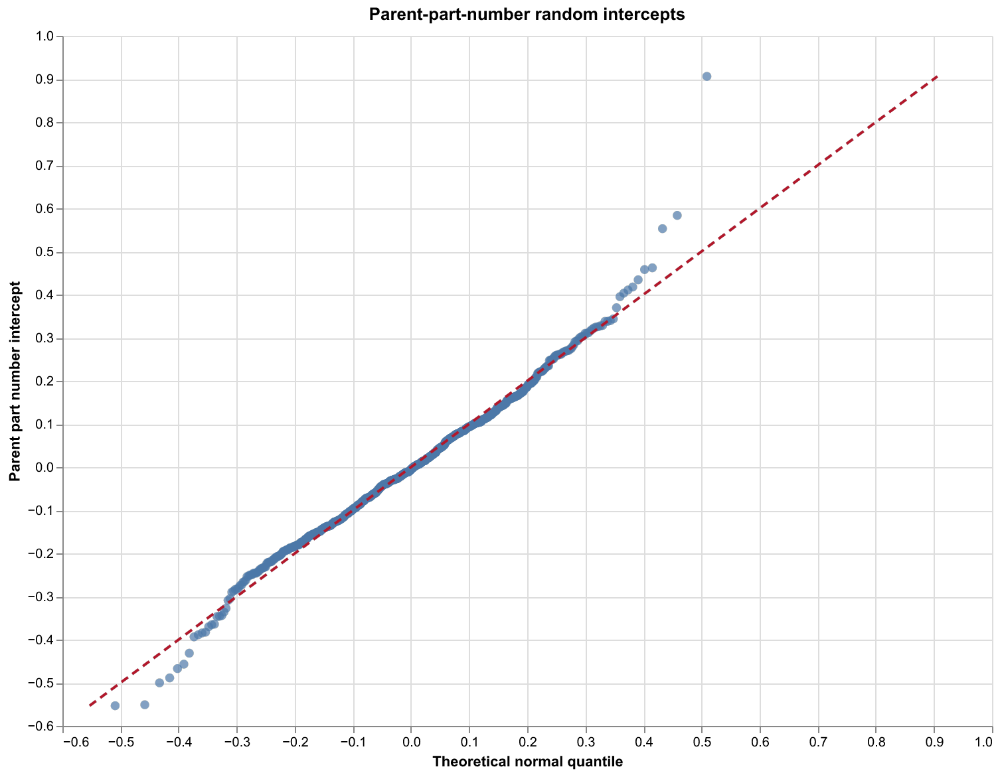
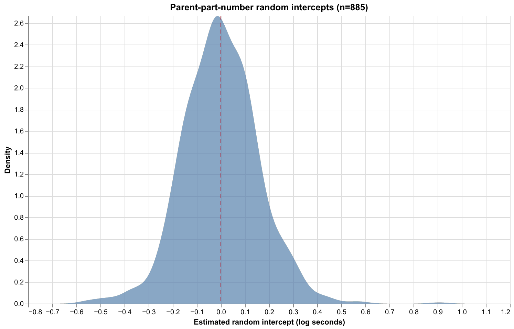
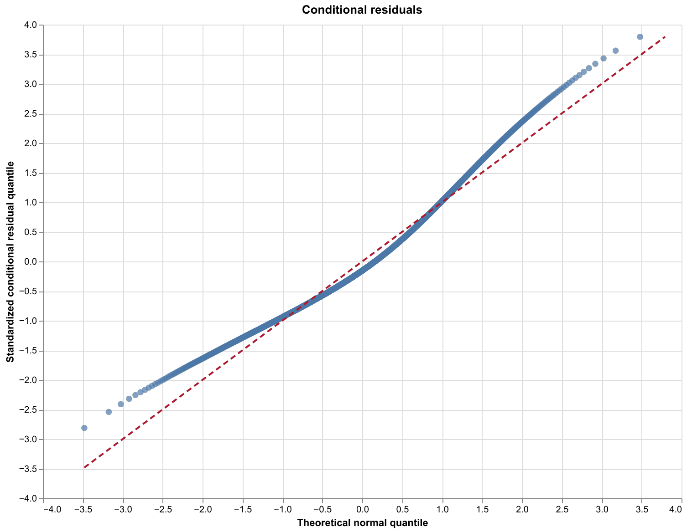
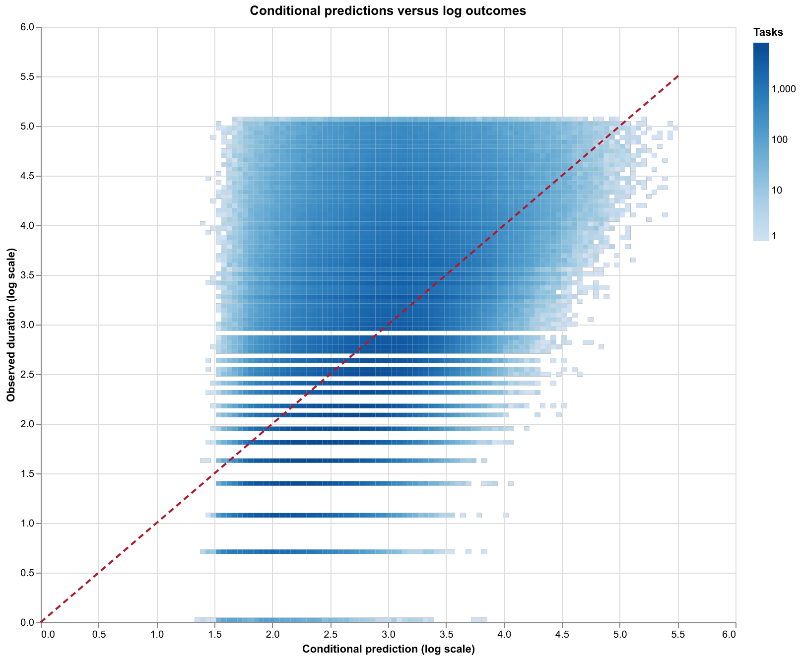

# test-model-final

This model keeps the natural log outcome, no-cell specification, fixed effects,
and user/date random intercepts of [test-model-exp](test-model-exp.md),
and adds a parent-part-number random intercept.
It changes the sequence indicators from cohort-and-pet batches to cohort-only
batches.

## Sample and indicators

The source is `EDLDB_DEV.PET_HEALTH_ANALYTICS_SANDBOX.MY_RXP_VALID_DUR_TASKS` through the
[cohort-only extract](../../../data/cohort_user_date_model_task_data.parquet). Missing parent part numbers
form a `<Missing>` level. The strict global
P95 filter retains 3,433,218 positive-duration tasks. For within-batch task
position $S_i=$ `COHORT_SEQN` and batch length $L_i=$
`COHORT_BATCH_LEN`, `SAME_PRECEDING` is
$P_i=\mathbf{1}(L_i>1\land S_i>1)$ and `SAME_FOLLOWING` is
$F_i=\mathbf{1}(L_i>1\land S_i<L_i)$. `HAS_CORRECTION` is
$C_i=\mathbf{1}(N_i>0)$ for correction count $N_i$.

| Indicator | Value | Tasks | Percent of retained tasks |
|---|---:|---:|---:|
| SAME_PRECEDING | 0 | 1,875,931 | 54.64% |
| SAME_PRECEDING | 1 | 1,557,287 | 45.36% |
| SAME_FOLLOWING | 0 | 1,878,842 | 54.73% |
| SAME_FOLLOWING | 1 | 1,554,376 | 45.27% |

## Model formula

With cohort $c_i$, pet type $p_i$, weekday $w_i$, approval channel $a_i$,
prescription source $s_i$, user $u(i)$, date $d(i)$, and parent part number $r(i)$:

$$
\log(Y_i)=\alpha+\beta_P P_i+\beta_F F_i+\beta_C C_i
 +\gamma_{c_i}+\delta_{p_i}+\theta_{w_i}
 +\phi_{a_i}+\psi_{s_i}+b_{u(i)}+h_{d(i)}+q_{r(i)}+\epsilon_i.
$$

There are no fixed cells. Cohort, pet type, weekday, approval channel, and
prescription source are additive fixed effects. Their reference levels are
`Cohort 1`, `Dog`, Sunday,
`PH`, and
`PRACTICE_HUB`, respectively. User, date, and
parent part number have independent random intercepts:
$b_u\sim N(0,\sigma_u^2)$, $h_d\sim N(0,\sigma_d^2)$, and
$q_r\sim N(0,\sigma_r^2)$, independently of
$\epsilon_i\sim N(0,\sigma_e^2)$. REML estimates the model. Fixed-effect
intervals and p-values use normal Wald approximations; random SD intervals
use observed information on the log-SD scale, and the residual SD interval
uses a chi-square approximation. The global intercept
$\widehat{\alpha}=3.034533$ applies to reference categories, zero
indicator values, and zero random intercepts.

## Sample and fit

| Quantity | Value |
|---|---:|
| Tasks | 3,433,218 |
| Fixed cells | 0 |
| Global intercept (log seconds) | 3.034533 |
| Users | 340 |
| Dates | 182 |
| Parent part numbers | 885 |
| Global approximate P95 cutoff (seconds) | 156.620823 |
| Conditional R-squared (log scale) | 0.300786 |
| Conditional RMSE (log seconds) | 0.767469 |
| REML negative log-likelihood | 3966831.492274 |
| Converged | True |

## Fixed effects

| Term | Estimate | SE | z | p-value | 95% CI | Significant |
|---|---:|---:|---:|---:|---:|:---:|
| SAME_PRECEDING | -0.034871 | 0.000858 | -40.6412 | <1e-300 | [-0.036552, -0.033189] | Yes |
| SAME_FOLLOWING | -0.001013 | 0.000858 | -1.1808 | 0.237696 | [-0.002695, 0.000669] | No |
| HAS_CORRECTION | 0.335919 | 0.001002 | 335.3143 | <1e-300 | [0.333956, 0.337883] | Yes |
| WEEKDAY_MON | 0.007606 | 0.024733 | 0.3075 | 0.758432 | [-0.040869, 0.056081] | No |
| WEEKDAY_TUE | 0.018008 | 0.024728 | 0.7282 | 0.46647 | [-0.030459, 0.066475] | No |
| WEEKDAY_WED | 0.013373 | 0.024734 | 0.5407 | 0.588742 | [-0.035105, 0.061851] | No |
| WEEKDAY_THU | 0.010322 | 0.024736 | 0.4173 | 0.67648 | [-0.038161, 0.058804] | No |
| WEEKDAY_FRI | 0.008029 | 0.024735 | 0.3246 | 0.745478 | [-0.040450, 0.056509] | No |
| WEEKDAY_SAT | 0.003198 | 0.024754 | 0.1292 | 0.897221 | [-0.045320, 0.051715] | No |
| COH[Cohort 2 vs Cohort 1] | 0.208007 | 0.016863 | 12.3352 | 5.85261e-35 | [0.174956, 0.241058] | Yes |
| COH[Cohort 3 vs Cohort 1] | 0.504763 | 0.017907 | 28.1880 | 8.19508e-175 | [0.469666, 0.539860] | Yes |
| COH[Cohort 4 vs Cohort 1] | 0.548922 | 0.035367 | 15.5210 | 2.50295e-54 | [0.479605, 0.618240] | Yes |
| COH[Unknown vs Cohort 1] | 0.610945 | 0.034303 | 17.8104 | 5.86458e-71 | [0.543713, 0.678177] | Yes |
| PETTYPE[<Missing> vs Dog] | -0.809849 | 0.542986 | -1.4915 | 0.135837 | [-1.874083, 0.254384] | No |
| PETTYPE[Bird vs Dog] | 0.430595 | 0.032426 | 13.2792 | 3.05603e-40 | [0.367041, 0.494149] | Yes |
| PETTYPE[Cat vs Dog] | 0.053896 | 0.002680 | 20.1127 | 5.71345e-90 | [0.048644, 0.059148] | Yes |
| PETTYPE[Farm Animal vs Dog] | 0.508492 | 0.192162 | 2.6462 | 0.008141 | [0.131862, 0.885123] | Yes |
| PETTYPE[Fish vs Dog] | 0.566626 | 0.146524 | 3.8671 | 0.000110128 | [0.279444, 0.853808] | Yes |
| PETTYPE[Horse vs Dog] | -0.023698 | 0.010410 | -2.2766 | 0.0228128 | [-0.044101, -0.003296] | Yes |
| PETTYPE[Reptile vs Dog] | 0.314481 | 0.050987 | 6.1679 | 6.92146e-10 | [0.214549, 0.414414] | Yes |
| PETTYPE[Small Pet vs Dog] | 0.322064 | 0.012358 | 26.0602 | 1.02986e-149 | [0.297842, 0.346287] | Yes |
| APPROVAL_CHANNEL[CLINIC_EMAIL vs PH] | 0.299482 | 0.057477 | 5.2105 | 1.88374e-07 | [0.186829, 0.412134] | Yes |
| APPROVAL_CHANNEL[CUSTOMER_MAIL vs PH] | 0.600193 | 0.016604 | 36.1479 | 4.01198e-286 | [0.567650, 0.632735] | Yes |
| APPROVAL_CHANNEL[DIGITAL vs PH] | 0.190563 | 0.051772 | 3.6808 | 0.000232496 | [0.089092, 0.292034] | Yes |
| APPROVAL_CHANNEL[FAX vs PH] | 0.258302 | 0.014273 | 18.0975 | 3.33691e-73 | [0.230328, 0.286277] | Yes |
| APPROVAL_CHANNEL[PARTNER vs PH] | -0.043703 | 0.010128 | -4.3149 | 1.59659e-05 | [-0.063555, -0.023852] | Yes |
| APPROVAL_CHANNEL[RHAPSODY vs PH] | 0.094970 | 0.066836 | 1.4209 | 0.155337 | [-0.036027, 0.225966] | No |
| APPROVAL_CHANNEL[VERBAL vs PH] | -0.020313 | 0.013558 | -1.4983 | 0.134062 | [-0.046885, 0.006259] | No |
| APPROVAL_CHANNEL[VET vs PH] | 0.012257 | 0.134401 | 0.0912 | 0.927334 | [-0.251165, 0.275679] | No |
| PRESCRIPTION_SOURCE[CLINIC_EMAIL vs PRACTICE_HUB] | -0.004722 | 0.014214 | -0.3322 | 0.739731 | [-0.032581, 0.023137] | No |
| PRESCRIPTION_SOURCE[CS_FIRST_CONTACT vs PRACTICE_HUB] | -0.109942 | 0.259207 | -0.4241 | 0.671457 | [-0.617979, 0.398094] | No |
| PRESCRIPTION_SOURCE[CUSTOMER_MAIL vs PRACTICE_HUB] | 0.054217 | 0.016288 | 3.3287 | 0.000872503 | [0.022294, 0.086141] | Yes |
| PRESCRIPTION_SOURCE[CVC vs PRACTICE_HUB] | 0.027068 | 0.066757 | 0.4055 | 0.685129 | [-0.103774, 0.157911] | No |
| PRESCRIPTION_SOURCE[DIGITAL vs PRACTICE_HUB] | 0.025127 | 0.050985 | 0.4928 | 0.622127 | [-0.074801, 0.125055] | No |
| PRESCRIPTION_SOURCE[FAX vs PRACTICE_HUB] | -0.007227 | 0.014269 | -0.5065 | 0.612511 | [-0.035193, 0.020739] | No |
| PRESCRIPTION_SOURCE[PARTNER_API vs PRACTICE_HUB] | 0.026072 | 0.010098 | 2.5818 | 0.00982729 | [0.006280, 0.045863] | Yes |
| PRESCRIPTION_SOURCE[RHAPSODY vs PRACTICE_HUB] | -0.039594 | 0.079752 | -0.4965 | 0.619565 | [-0.195905, 0.116717] | No |
| PRESCRIPTION_SOURCE[TELEMEDICINE vs PRACTICE_HUB] | 0.236886 | 0.067306 | 3.5196 | 0.000432265 | [0.104970, 0.368803] | Yes |
| PRESCRIPTION_SOURCE[VERBAL vs PRACTICE_HUB] | -0.004447 | 0.014919 | -0.2981 | 0.76563 | [-0.033689, 0.024794] | No |

The `SAME_PRECEDING` estimate corresponds to an adjusted duration ratio of
$\exp(\widehat{\beta}_P)=0.965730$, or
-3.43% (95% CI [-3.59%, -3.26%]).
This is a conditional log-scale association, not a causal effect.

## All DUR task processing time

A read-only query of all TASK_TYPE = 'DUR' rows in
EDLDB_DEV.PET_HEALTH_ANALYTICS_SANDBOX.MY_RXP_TASKS on
2026-10-14 returned 4,128,486 tasks and
212,095,618 imputed processing seconds
(58,915.45 hours). Their process dates span
2026-02-01 through 2026-08-04.
The imputed duration is COALESCE(DWELL_IN_PROGRESS_TO_CLOSED_SECONDS, 1);
19,550 DUR rows have a null raw duration.
This full-table total includes tasks outside the filtered model sample.

### Handoff type distribution for all DUR tasks

| Handoff type | DUR tasks | Processing time (seconds) | Hours |
|---|---:|---:|---:|
| `NULL` | 4,000,758 | 197,557,538 | 54,877.09 |
| `PHARMACIST_FOLLOW_UP` | 117,503 | 13,334,300 | 3,703.97 |
| `TECHNICIAN_FOLLOW_UP` | 6,736 | 820,191 | 227.83 |
| `LEAD_FOLLOW_UP` | 3,489 | 383,589 | 106.55 |
| **All DURs** | **4,128,486** | **212,095,618** | **58,915.45** |

The `NULL` row includes tasks without a handoff type. No DUR row has a blank
handoff type. These totals
come from the [read-only handoff-type query](../../../src/sql/my_rxp_tasks_handoff_type.sql).
The valid-DUR sample requires `HANDOFF_TYPE IS NULL`.

### Intersection status for DUR tasks with NULL handoff type

| Intersection status | DUR tasks | Processing time (seconds) | Hours |
|---|---:|---:|---:|
| Intersecting | 332,599 | 16,046,580 | 4,457.38 |
| Not intersecting | 3,668,159 | 181,510,958 | 50,419.71 |
| **All DURs with NULL handoff type** | **4,000,758** | **197,557,538** | **54,877.09** |

An intersecting DUR has `N_INTERSECTING_TASKS > 0` in
`MY_RXP_TASKS_WITH_SEQUENCE`: its processing interval overlaps another task
for the same user. The [read-only intersection query](../../../src/sql/dur_null_handoff_processing_time_by_intersection.sql)
uses DUR tasks with `HANDOFF_TYPE IS NULL`, without the model's other validity
or duration-cutoff filters. Every such DUR task had a sequence record.

To regenerate the aggregate, run the
[read-only SQL](../../../src/sql/total_dur_processing_time.sql) from the repository root:

    .venv/bin/python skills/rxp-sql/scripts/run_snowflake_query.py src/sql/total_dur_processing_time.sql

## Variance components

| Component | SD (log scale) | Approximate 95% CI |
|---|---:|---:|
| User random intercept | 0.545034 | [0.503849, 0.589586] |
| Date random intercept | 0.088873 | [0.079975, 0.098762] |
| Parent-part-number random intercept | 0.169522 | [0.160562, 0.178982] |
| Residual | 0.767615 | [0.767041, 0.768189] |

## Interpretation and assumptions

The model assumes additive effects, independent normally distributed user,
date, and parent-part-number intercepts and residuals, and a common log-scale
residual variance. Unmodeled user, date, and parent-part differences must be
unrelated to the included predictors after adjustment for the random-intercept
interpretation. This
remains an observational association. It is not directly comparable to the
paired t-test, which uses a different task population and preceding-task rule.
Coefficients and fit measures on the log scale are not directly comparable to
those on the Box-Cox scale in `test-model`. This model and `test-model-exp`
also estimate different sequence associations because their preceding and
following indicators use different batch definitions.

## Diagnostics and artifacts

The date random-intercept Q–Q plot departs strongly from a normal line, and
the date intercept density shows a second positive peak. The residual Q–Q
plot curves in both tails. The parent-part-number Q–Q plot is broadly aligned
with the normal line except for a few tail values. The reported confidence
intervals are model-based approximations under the stated distributional
assumptions.

Each density plot gives one fitted intercept equal weight per user, date, or
parent part number; the dashed vertical line marks zero.

- [Shared generated SQL](../../../generated/cohort_user_date_model.sql)
- [Shared raw task data](../../../data/cohort_user_date_model_task_data.parquet)
- [Log-transformed model data](../../../data/test_model_final_log_data.parquet)
- [Fixed-effect table](../../tables/test_model_final_fixed_effects.md)
- [User-effect table](../../tables/test_model_final_user_effects.md)
- [Date-effect table](../../tables/test_model_final_date_effects.md)
- [Parent-part-number-effect table](../../tables/test_model_final_parent_effects.md)
- [User-effect data](../../../data/test_model_final_user_effects.parquet)
- [Date-effect data](../../../data/test_model_final_date_effects.parquet)
- [Parent-part-number-effect data](../../../data/test_model_final_parent_effects.parquet)

## All-eligible same-preceding counterfactual

| DUR population | Number of DURs | Total processing time (seconds) | Hours |
|---|---:|---:|---:|
| Valid DURs below 156.608019 seconds | 3,433,218 | 89,130,671 | 24,758.52 |
| Valid DURs at or above 156.608019 seconds | 180,803 | 88,958,419 | 24,710.67 |
| **All valid DURs** in `MY_RXP_VALID_DUR_TASKS` | **3,614,021** | **178,089,090** | **49,469.19** |
| Other non-intersecting DURs excluded by validity checks | 54,138 | 3,421,868 | 950.52 |
| **All non-intersecting DURs with NULL handoff type** | **3,668,159** | **181,510,958** | **50,419.71** |
| All DURs below 156.608019 seconds in `MY_RXP_TASKS` | 3,905,692 | 104,384,954 | 28,995.82 |
| **All DURs** in `MY_RXP_TASKS` | **4,128,486** | **212,095,618** | **58,915.45** |

These are imputed processing durations from the [all-DUR](../../../src/sql/total_dur_processing_time.sql),
[below-cutoff](../../../src/sql/total_dur_below_model_p95.sql), and
[valid-DUR](../../../src/sql/total_valid_dur_processing_time.sql) read-only queries on 2026-10-14.
The cutoff comes from the model's eligible sample and is applied here to all
DURs in `MY_RXP_TASKS` as well as to the valid-DUR breakdown.
The [valid-DUR cutoff breakdown](../../../src/sql/valid_dur_model_p95_breakdown.sql)
shows why the totals differ. The first two rows partition the valid-DUR table at the model cutoff;
the valid tasks below it are the 3,433,218-task model sample.
The 54,138 other non-intersecting tasks and 3,421,868 seconds are the difference
between the null-handoff non-intersecting population
and the valid-DUR table; the available aggregate does not
separate their individual exclusion reasons. The full-table
below-cutoff row also includes 472,474 other DUR tasks totaling
15,254,283 seconds that did not meet the valid-DUR criteria.

Within each user, process date, and cohort, all retained tasks are ordered by
PROCESS_START_TIME (TASK_ID resolves an exact timestamp tie). The first task
in each list keeps its original duration, whether SAME_PRECEDING is 0 or 1.
Later tasks with SAME_PRECEDING = 0 receive the fitted duration ratio
exp(beta_P) = 0.965730; tasks already marked 1 are
unchanged. This is an arithmetic scenario using observed durations and a
single fitted association, not a causal estimate or a prediction of how task
ordering would change.

| Quantity | Value |
|---|---:|
| First retained process date | 2026-02-01 |
| Last retained process date | 2026-08-01 |
| User-day-cohorts / unchanged first tasks | 64,681 |
| Additional tasks adjusted | 1,814,117 |
| Original total (seconds) | 89,130,671.0 |
| Adjusted total (seconds) | 87,458,136.9 |
| Difference (hours) | 464.6 |
| Change from original | -1.88% |
| Pharmacist cost per hour | $90.00 |
| Implied labor value | $41,813.35 |

| Cohort | Tasks | Adjusted tasks | Original seconds | Adjusted seconds | Difference seconds | Change | Labor value |
|---|---:|---:|---:|---:|---:|---:|---:|
| Cohort 1 | 1,904,176 | 862,667 | 43,800,431.0 | 43,103,502.2 | 696,928.8 | -1.59% | $17,423.22 |
| Cohort 2 | 1,331,432 | 791,247 | 37,428,756.0 | 36,667,828.8 | 760,927.2 | -2.03% | $19,023.18 |
| Cohort 3 | 159,018 | 132,205 | 6,121,581.0 | 5,950,003.0 | 171,578.0 | -2.80% | $4,289.45 |
| Cohort 4 | 17,615 | 13,962 | 868,270.0 | 845,453.7 | 22,816.3 | -2.63% | $570.41 |
| Unknown | 20,977 | 14,036 | 911,633.0 | 891,349.3 | 20,283.7 | -2.22% | $507.09 |

The [cohort totals](../../tables/test_model_final_counterfactual_cohort.md),
[user-day totals](../../tables/test_model_final_counterfactual_user_day.md), and
[user-day-cohort totals](../../tables/test_model_final_counterfactual_user_day_cohort.md)
give the underlying aggregates.

The implied labor value is
(89,130,671.0 - 87,458,136.9) / 3,600 × $90.00
= $41,813.35.
Realizing cash savings would depend on staffing decisions.
