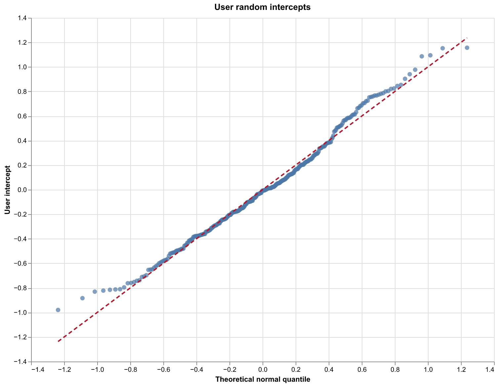
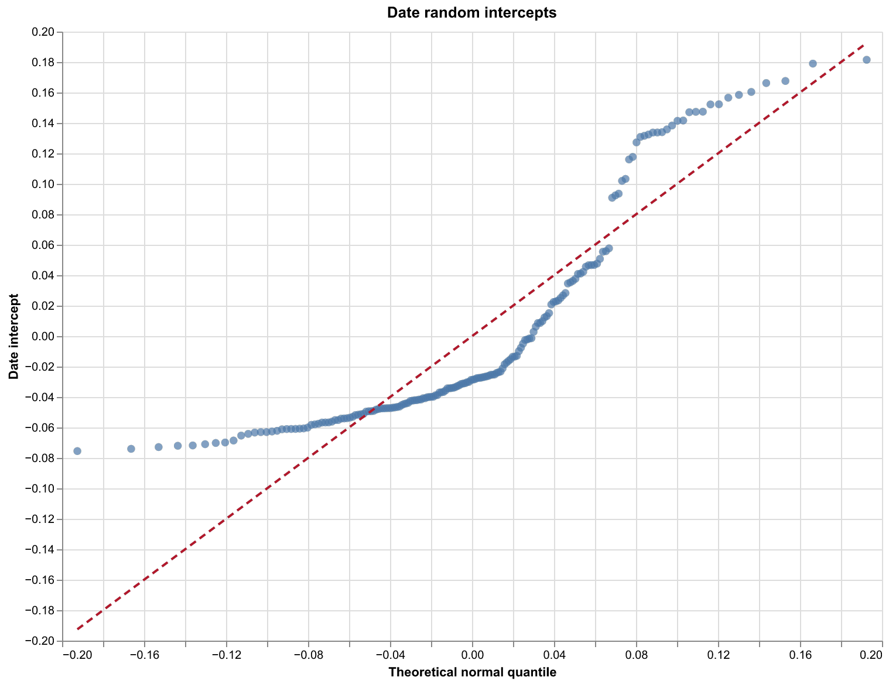
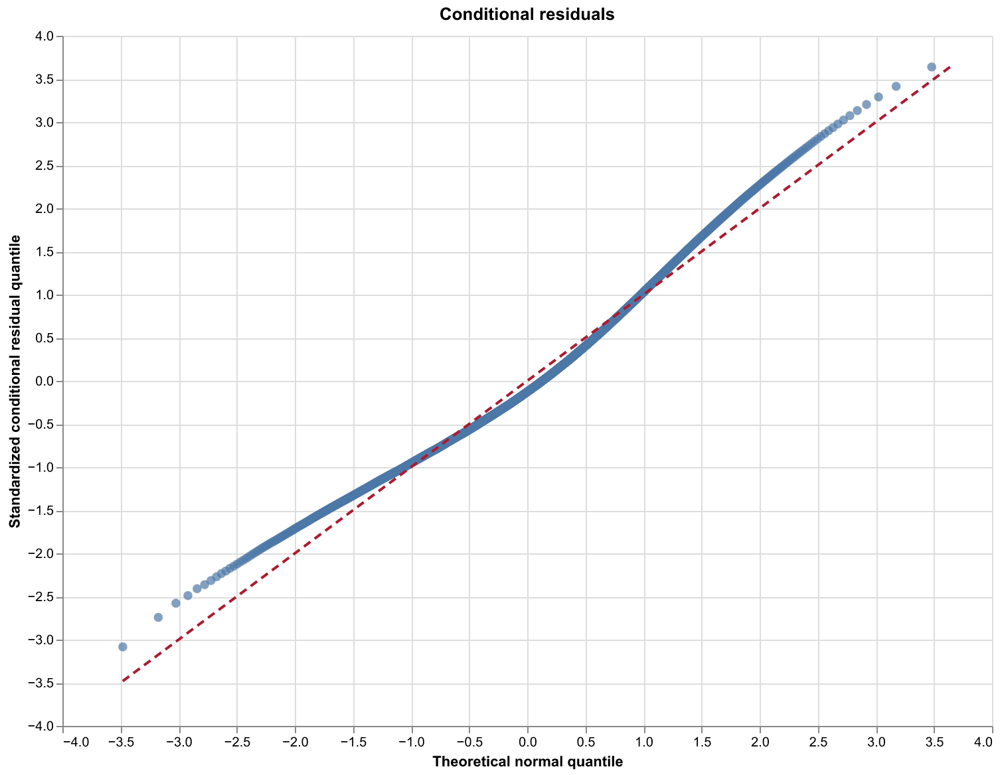
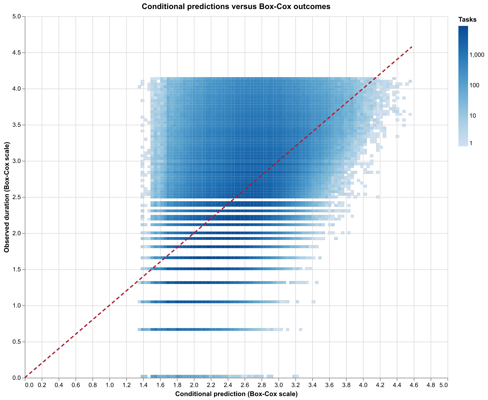

# test-model

No cells: one global intercept, cohort and pet type fixed effects, and user
and date random intercepts.

## Sample and indicators

This model uses the [cohort-and-pet extract](../../../data/cohort_user_date_pettype_cell_model_task_data.parquet) from
`EDLDB_DEV.PET_HEALTH_ANALYTICS_SANDBOX.MY_RXP_VALID_DUR_TASKS` and the same strict global P95 filter. Within each
valid-DUR cohort-and-pet batch, `COHORT_PET_SEQN` is task position and
`COHORT_PET_BATCH_LEN` is batch length. For position $S_i$ and length $L_i$,
`SAME_PRECEDING` is $P_i=\mathbf{1}(L_i>1\land S_i>1)$ and the
`SAME_FOLLOWING` placebo is $F_i=\mathbf{1}(L_i>1\land S_i<L_i)$.
`HAS_CORRECTION` is $C_i=\mathbf{1}(N_i>0)$ for correction count $N_i$.
The 3,433,218 retained tasks receive one global Box-Cox transform of
duration, with $\widehat{\lambda}=-0.08159843$.

| Indicator | Value | Tasks | Percent of retained tasks |
|---|---:|---:|---:|
| SAME_PRECEDING | 0 | 3,306,380 | 96.31% |
| SAME_PRECEDING | 1 | 126,838 | 3.69% |
| SAME_FOLLOWING | 0 | 3,308,095 | 96.36% |
| SAME_FOLLOWING | 1 | 125,123 | 3.64% |

## Model formula

Let $Z_i=g_\lambda(Y_i)$ be transformed duration, $c_i$ cohort, $p_i$ pet
type, $w_i$ weekday, $a_i$ approval channel, and $s_i$ prescription source.
With one reference level omitted from each categorical effect:

$$
Z_i=\alpha+\beta_P P_i+\beta_F F_i+\beta_C C_i
 +\gamma_{c_i}+\delta_{p_i}+\theta_{w_i}
 +\phi_{a_i}+\psi_{s_i}+b_{u(i)}+h_{d(i)}+\epsilon_i.
$$

There are no fixed cells. Cohort, pet type, weekday, approval channel, and
prescription source enter as additive fixed effects. The reference levels are
`Cohort 1` (cohort), `Dog` (pet
type), Sunday (weekday), `PH` (approval
channel), and `PRACTICE_HUB` (prescription source).
The random intercepts are independent:
$b_u\sim N(0,\sigma_u^2)$, $h_d\sim N(0,\sigma_d^2)$, and
$\epsilon_i\sim N(0,\sigma_e^2)$. REML estimates the model. Fixed-effect
confidence intervals and p-values use normal Wald approximations; random SD
intervals use observed information on the log-SD scale, and the residual SD
interval uses a chi-square approximation. Estimates are on the Box-Cox scale.
The global intercept is $\widehat{\alpha}=2.553233$ for the reference
categories, zero indicator values, and zero random intercepts.

## Sample and fit

| Quantity | Value |
|---|---:|
| Tasks | 3,433,218 |
| Fixed cells | 0 |
| Global intercept (Box-Cox scale) | 2.553233 |
| Users | 340 |
| Dates | 182 |
| Global approximate P95 cutoff (seconds) | 156.487990 |
| Box-Cox lambda | -0.08159843 |
| Conditional R-squared | 0.296595 |
| Conditional RMSE | 0.608974 |
| REML negative log-likelihood | 3170848.621061 |
| Converged | True |

## Fixed effects

| Term | Estimate | SE | z | p-value | 95% CI | Significant |
|---|---:|---:|---:|---:|---:|:---:|
| SAME_PRECEDING | -0.136583 | 0.001750 | -78.0538 | <1e-300 | [-0.140013, -0.133153] | Yes |
| SAME_FOLLOWING | 0.000090 | 0.001761 | 0.0513 | 0.959104 | [-0.003362, 0.003542] | No |
| HAS_CORRECTION | 0.283712 | 0.000790 | 359.2218 | <1e-300 | [0.282164, 0.285260] | Yes |
| WEEKDAY_MON | 0.006588 | 0.019674 | 0.3348 | 0.73774 | [-0.031973, 0.045148] | No |
| WEEKDAY_TUE | 0.015304 | 0.019671 | 0.7780 | 0.436556 | [-0.023250, 0.053858] | No |
| WEEKDAY_WED | 0.012335 | 0.019675 | 0.6269 | 0.530721 | [-0.026228, 0.050897] | No |
| WEEKDAY_THU | 0.010274 | 0.019677 | 0.5221 | 0.601582 | [-0.028293, 0.048841] | No |
| WEEKDAY_FRI | 0.007716 | 0.019676 | 0.3921 | 0.694957 | [-0.030848, 0.046280] | No |
| WEEKDAY_SAT | 0.003665 | 0.019691 | 0.1861 | 0.852343 | [-0.034929, 0.042259] | No |
| COH[Cohort 2 vs Cohort 1] | 0.170763 | 0.000699 | 244.2865 | <1e-300 | [0.169392, 0.172133] | Yes |
| COH[Cohort 3 vs Cohort 1] | 0.448887 | 0.001642 | 273.3316 | <1e-300 | [0.445669, 0.452106] | Yes |
| COH[Cohort 4 vs Cohort 1] | 0.729218 | 0.004654 | 156.6736 | <1e-300 | [0.720096, 0.738340] | Yes |
| COH[Unknown vs Cohort 1] | 0.602750 | 0.004256 | 141.6323 | <1e-300 | [0.594409, 0.611091] | Yes |
| PETTYPE[<Missing> vs Dog] | -0.721567 | 0.430668 | -1.6755 | 0.093844 | [-1.565661, 0.122527] | No |
| PETTYPE[Bird vs Dog] | 0.432926 | 0.024874 | 17.4047 | 7.59746e-68 | [0.384174, 0.481678] | Yes |
| PETTYPE[Cat vs Dog] | 0.102006 | 0.001015 | 100.5178 | <1e-300 | [0.100017, 0.103995] | Yes |
| PETTYPE[Farm Animal vs Dog] | 0.406061 | 0.152347 | 2.6654 | 0.00769034 | [0.107467, 0.704655] | Yes |
| PETTYPE[Fish vs Dog] | 0.514422 | 0.113100 | 4.5484 | 5.40634e-06 | [0.292749, 0.736094] | Yes |
| PETTYPE[Horse vs Dog] | -0.070925 | 0.002889 | -24.5470 | 4.66126e-133 | [-0.076588, -0.065262] | Yes |
| PETTYPE[Reptile vs Dog] | 0.244496 | 0.039908 | 6.1265 | 8.98568e-10 | [0.166277, 0.322714] | Yes |
| PETTYPE[Small Pet vs Dog] | 0.367579 | 0.009359 | 39.2761 | <1e-300 | [0.349236, 0.385922] | Yes |
| APPROVAL_CHANNEL[CLINIC_EMAIL vs PH] | 0.254312 | 0.045593 | 5.5779 | 2.43416e-08 | [0.164952, 0.343673] | Yes |
| APPROVAL_CHANNEL[CUSTOMER_MAIL vs PH] | 0.483553 | 0.013170 | 36.7155 | 4.13353e-295 | [0.457739, 0.509366] | Yes |
| APPROVAL_CHANNEL[DIGITAL vs PH] | 0.156371 | 0.041073 | 3.8072 | 0.00014056 | [0.075870, 0.236872] | Yes |
| APPROVAL_CHANNEL[FAX vs PH] | 0.212481 | 0.011321 | 18.7690 | 1.35411e-78 | [0.190293, 0.234670] | Yes |
| APPROVAL_CHANNEL[PARTNER vs PH] | -0.044448 | 0.008020 | -5.5423 | 2.98524e-08 | [-0.060166, -0.028729] | Yes |
| APPROVAL_CHANNEL[RHAPSODY vs PH] | 0.107041 | 0.053008 | 2.0193 | 0.0434549 | [0.003146, 0.210935] | Yes |
| APPROVAL_CHANNEL[VERBAL vs PH] | -0.001830 | 0.010753 | -0.1702 | 0.864858 | [-0.022906, 0.019246] | No |
| APPROVAL_CHANNEL[VET vs PH] | 0.016344 | 0.106621 | 0.1533 | 0.878172 | [-0.192629, 0.225316] | No |
| PRESCRIPTION_SOURCE[CLINIC_EMAIL vs PRACTICE_HUB] | -0.010929 | 0.011274 | -0.9694 | 0.332362 | [-0.033026, 0.011168] | No |
| PRESCRIPTION_SOURCE[CS_FIRST_CONTACT vs PRACTICE_HUB] | -0.103720 | 0.205630 | -0.5044 | 0.613978 | [-0.506747, 0.299307] | No |
| PRESCRIPTION_SOURCE[CUSTOMER_MAIL vs PRACTICE_HUB] | 0.031940 | 0.012919 | 2.4722 | 0.0134279 | [0.006618, 0.057261] | Yes |
| PRESCRIPTION_SOURCE[CVC vs PRACTICE_HUB] | -0.002062 | 0.052946 | -0.0389 | 0.968936 | [-0.105834, 0.101710] | No |
| PRESCRIPTION_SOURCE[DIGITAL vs PRACTICE_HUB] | 0.019840 | 0.040444 | 0.4905 | 0.623752 | [-0.059430, 0.099109] | No |
| PRESCRIPTION_SOURCE[FAX vs PRACTICE_HUB] | -0.012758 | 0.011318 | -1.1272 | 0.25965 | [-0.034940, 0.009425] | No |
| PRESCRIPTION_SOURCE[PARTNER_API vs PRACTICE_HUB] | 0.031065 | 0.007987 | 3.8895 | 0.00010044 | [0.015411, 0.046719] | Yes |
| PRESCRIPTION_SOURCE[RHAPSODY vs PRACTICE_HUB] | -0.066144 | 0.063257 | -1.0457 | 0.295722 | [-0.190125, 0.057836] | No |
| PRESCRIPTION_SOURCE[TELEMEDICINE vs PRACTICE_HUB] | 0.137222 | 0.053348 | 2.5722 | 0.0101063 | [0.032660, 0.241783] | Yes |
| PRESCRIPTION_SOURCE[VERBAL vs PRACTICE_HUB] | -0.008161 | 0.011833 | -0.6897 | 0.490373 | [-0.031353, 0.015030] | No |

## Variance components

| Component | SD | Approximate 95% CI |
|---|---:|---:|
| User random intercept | 0.420982 | [0.389217, 0.455340] |
| Date random intercept | 0.070698 | [0.063619, 0.078564] |
| Residual | 0.609022 | [0.608567, 0.609478] |

## Interpretation and assumptions

`SAME_PRECEDING` is an adjusted observational association, not a causal
effect. The coefficient uses comparisons both within and across cohorts, pet
types, users, and dates after additive adjustment; it has a different
interpretation from the fixed-cell model. The model assumes additive effects,
normally distributed independent user/date intercepts and residuals, and a
common residual variance on the Box-Cox scale. Unmodeled user and date
differences must be unrelated to the included predictors after adjustment
for the random-intercept interpretation. The paired t-test is also
observational and uses a different task population and preceding-task rule.

## Diagnostics and artifacts

The date random-intercept Q–Q plot departs strongly from a normal line, and
the residual Q–Q plot curves in both tails. The reported confidence intervals
are model-based approximations under the stated distributional assumptions.

- [Shared generated SQL](../../../generated/cohort_user_date_pettype_cell_model.sql)
- [Shared raw task data](../../../data/cohort_user_date_pettype_cell_model_task_data.parquet)
- [Transformed model data](../../../data/test_model_boxcox_data.parquet)
- [Fixed-effect table](../../tables/test_model_fixed_effects.md)
- [User-effect table](../../tables/test_model_user_effects.md)
- [Date-effect table](../../tables/test_model_date_effects.md)
- [User-effect data](../../../data/test_model_user_effects.parquet)
- [Date-effect data](../../../data/test_model_date_effects.parquet)
